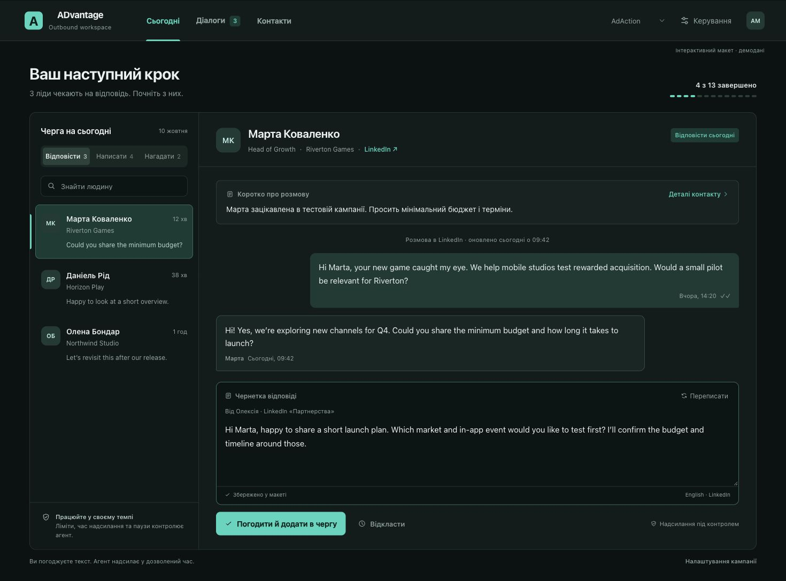

# Макет робочого місця продавця

Окремий інтерактивний макет Outbound Sales у темній палітрі: фон `#091211`, панелі `#111c1b`, акцент `#34d6bd`.

Вкладки: **Сьогодні**, **Діалоги**, **Контакти**, **Керування**. Є пошук (до п'яти найближчих збігів), редагування чернетки та погодження в демонстраційну чергу. Макет адаптований для комп'ютера й телефона.

## Запуск

Із кореня репозиторію:

```sh
python3 -m http.server 8080 --bind 127.0.0.1 --directory prototypes/sales-workspace
```

Відкрити [http://127.0.0.1:8080/](http://127.0.0.1:8080/). Залежності та збірка не потрібні; також можна відкрити `index.html` у браузері.

## Межі макета

Усі контакти й повідомлення вигадані. Макет не підключений до CRM, LinkedIn або агента й не надсилає повідомлень. Зміни зберігаються лише в пам'яті вкладки та скидаються після перезавантаження. Кнопка «Скинути демо» також відновлює початковий стан.

Ця папка не замінює поточний інтерфейс застосунку. Інтеграція в робочий сайт потребує окремої реалізації.

## Перегляд



[Мобільна переписка](screenshots/mobile.jpg)
